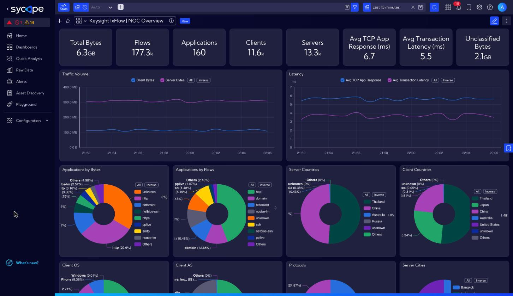
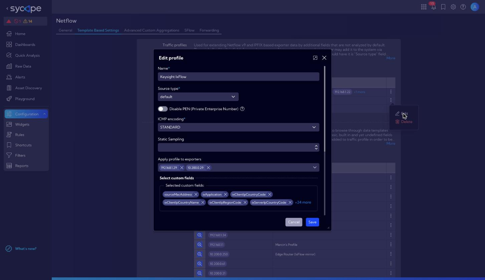
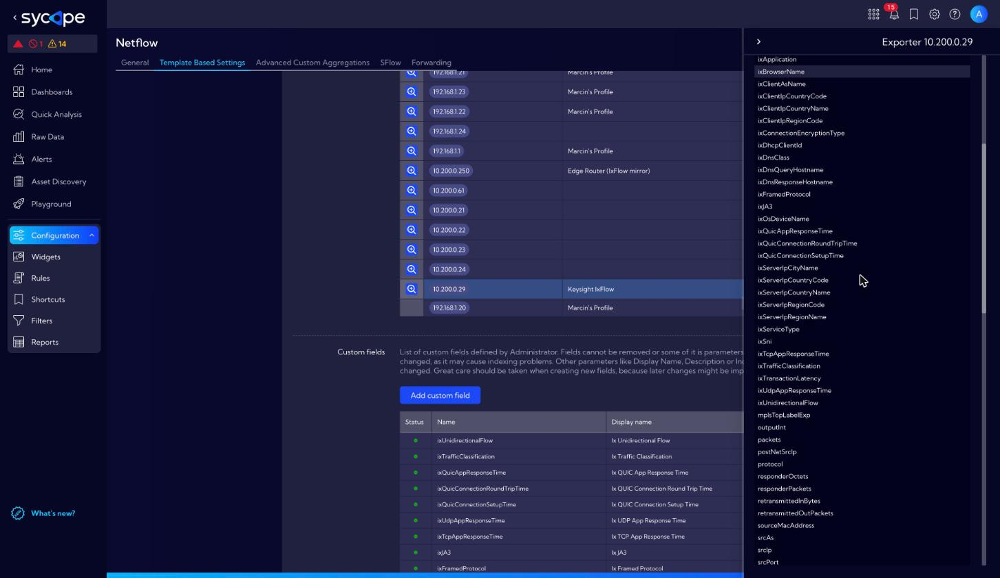
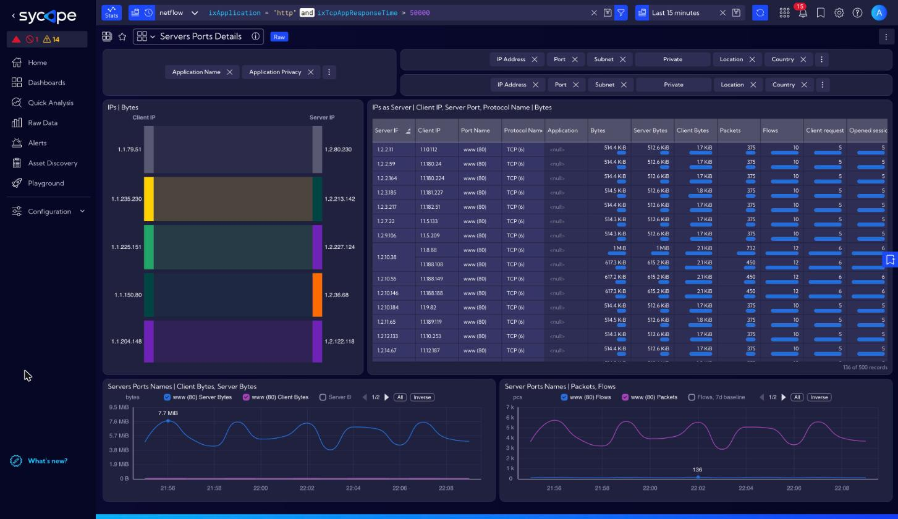
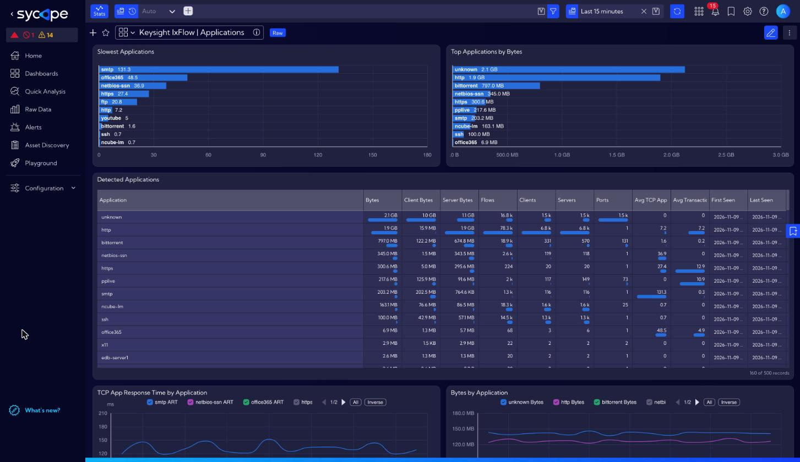
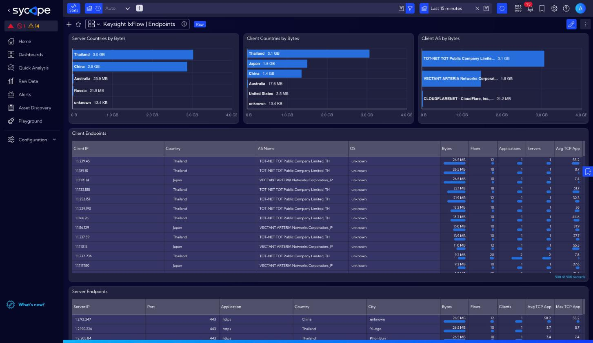
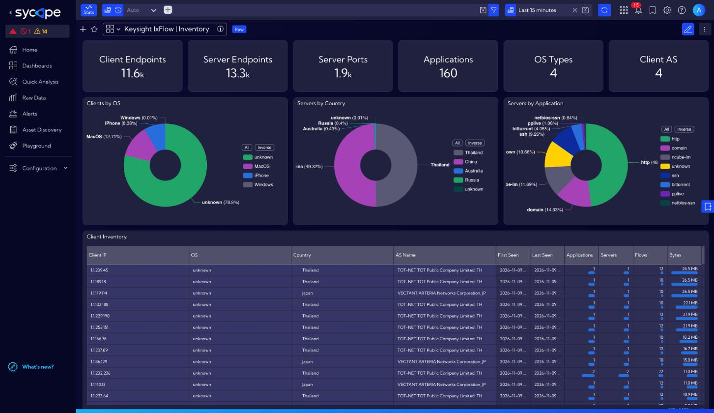
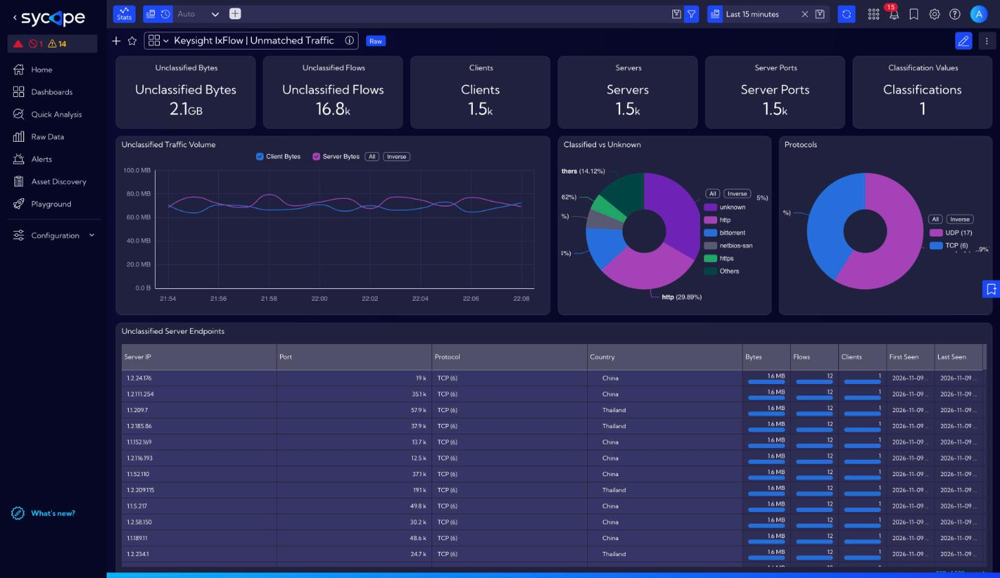

# Keysight IxFlow Integration with Sycope

Use **Keysight IxFlow** (AppStack application intelligence on Keysight Vision / CloudLens network packet brokers) as a NetFlow/IPFIX source in **Sycope**.
IxFlow enriches every flow with Layer 7 metadata - application name, application response time and transaction latency, client OS and browser, geolocation, AS names, DNS host names, TLS SNI/JA3 - and exports it as IPFIX enterprise elements (PEN 3054).
This integration configures Sycope to decode those elements, provides five ready-to-use dashboards and shows how to use the IxFlow fields in every standard Sycope dashboard (for example *Port Details*).

> **Sycope is available as a [free version](https://free.sycope.com/)** supporting up to 5,000 flows/second with no limitations on data sources, subnetworks, or number of monitored hosts. The free version includes threat detection, anomaly detection, and personalized dashboards — making it viable for production use without a license cost. The main differences vs. the paid version are data retention (14 days vs. unlimited), access management (single admin role vs. full RBAC), and probes monitoring availability.



---

## What's included

- **28 NetFlow custom fields** (`ix*`) for the IxFlow elements Sycope can store - application, KPIs, geolocation, device, DNS, TLS, DHCP, RADIUS
- **Traffic profile** (*Template Based Settings*) `Keysight IxFlow`, created by a Python script and assigned to your IxFlow exporters
- **Flow verification script** that checks templates, profile binding and the fill rate of every IxFlow field
- **5 dashboards** in the Sycope 3.3 format; a converter in the shared library makes them importable into Sycope 3.2
- **3 saved fields** with the latency metrics converted to milliseconds
- **Replay tool** that re-exports an IxFlow pcap capture as live IPFIX, for labs and demos

---

## How it works

```
 Keysight packet broker            Sycope
 (NVOS + AppStack)                 NetFlow collector (UDP/2055)
 ┌──────────────────┐  IPFIX      ┌───────────────────────────────────────────────┐
 │ IxFlow export    │ ──────────▶ │ template-based settings: profile              │
 │ IANA + PEN 3054  │             │ "Keysight IxFlow" (28 ix* fields)             │
 └──────────────────┘             │        │                                      │
                                  │        ▼                                      │
                                  │ netflow stream: standard fields + ix* fields  │
                                  │        │                                      │
                                  │        ├─▶ Keysight IxFlow dashboards         │
                                  │        └─▶ standard dashboards + ix* filters  │
                                  └───────────────────────────────────────────────┘
```

Standard IPFIX elements (addresses, ports, protocol, bytes, packets, AS numbers, timestamps) are decoded by Sycope out of the box.
IxFlow-specific elements use the enterprise number **3054** and are decoded only when the exporter is assigned a traffic profile that contains a matching custom field.
`install.py` creates these fields and the profile through the Sycope REST API.

---

## Repository Content

```
keysight/
├── README.md
├── config.json                 # Configuration file
├── requirements.txt
├── install.py                  # Creates fields, traffic profile, exporter binding, saved fields, dashboards
├── uninstall.py                # Removes everything install.py created
├── verify_flows.py             # Checks that IxFlow records arrive with the expected fields
├── fields/
│   ├── netflow_fields.json     # IxFlow element -> Sycope custom field definitions
│   └── saved_fields/           # Saved fields (latency in ms), importable from the GUI as well
├── dashboards/
│   └── *.json                  # 5 dashboards (Sycope 3.3 format)
├── docs/
│   ├── field_reference.md      # Every IxFlow element: mapped, colliding, unsupported
│   └── screenshots/
└── tools/
    ├── ixflow_replay.py        # Replays an IxFlow pcap as live IPFIX (lab / demo)
    └── ixflow-replay.service   # Example systemd unit for the replay tool
```

The scripts use the shared Sycope library from [`../sycope`](../sycope): `sycope.api` (login, NQL), `sycope.netflow` (fields, traffic profiles, exporters) and `sycope.dashboards` (dashboards, saved fields).

> **Scripts can be executed on any host with HTTPS access to Sycope. Due to permissions and other limitations, please do not run them on Sycope Appliance.**

---

## Requirements

**Keysight**
- Packet broker with **AppStack** and an **IxFlow (NetFlow/IPFIX) export** enabled. Tested with an export from NVOS 6.4.1.3 / AppStack 4.9.2.
- IPFIX (version 10) export to the Sycope collector, UDP **2055** by default.
- Templates sent periodically. Sycope cannot decode records until it receives the templates, for example after a collector restart.
- The metadata you want in Sycope selected in the IxFlow export profile: application, geolocation, device/OS, browser, KPIs, DNS, TLS, and so on.

**Sycope**
- Sycope **3.2** or **3.3** with REST API access.
- A user allowed to change NetFlow settings and to create dashboards and saved fields (`admin` or equivalent).
- The IP address of every IxFlow exporter as seen by Sycope (the source IP of the IPFIX packets).

**Host running the scripts**
- Python 3.8+
- `requests` module:
  ```bash
  pip3 install -r requirements.txt
  ```

---

## Installation

```bash
git clone https://github.com/SycopeSolutions/Integrations.git
cd Integrations/keysight
pip3 install -r requirements.txt
# edit config.json (see below)
python3 install.py --dry-run     # shows what would be created, writes nothing
python3 install.py               # Sycope 3.3
python3 install.py --sycope-3.2  # Sycope 3.2 (legacy): dashboards converted to the 3.2 format first
```

`install.py` runs five steps. Each one is idempotent, so running the script again only adds what is missing and updates the dashboards in place:

| Step | What it does |
|---|---|
| 1. NetFlow custom fields | Creates the 28 `ix*` fields from `fields/netflow_fields.json`. An element id that is already used by another field is skipped with a warning. |
| 2. Traffic profile | Creates the traffic profile `Keysight IxFlow` with those fields and `sourceMacAddress`. If the profile exists, the script updates its field list. |
| 3. Exporter binding | Assigns the profile to every IP in `exporter_ips`. An exporter that already uses another profile is **not** changed; the script reports it so you can decide in the GUI. |
| 4. Saved fields | Imports `fields/saved_fields/*.json`. |
| 5. Dashboards | Imports the 5 dashboards from `dashboards/` through the API (works with Sycope 3.2 and 3.3). |

Before changing anything the script saves the current fields, profiles and exporter bindings to `backups/netflow_config_<timestamp>.json`.

Options: `--dry-run`, `--skip-assign`, `--skip-saved-fields`, `--skip-dashboards`, `--sycope-3.2`.

### Manual alternative (GUI)

If you prefer the GUI, go to **Settings → NetFlow → Template Based Settings**. Add a custom field for each row of the table in [docs/field_reference.md](docs/field_reference.md#1-supported-elements-created-by-installpy), create a traffic profile with these fields and assign it to the exporter IP.
Then import the dashboards and saved fields as described in [Dashboards](#dashboards).



---

## Configuration (`config.json`)

```json
{
  "log_level": "info",
  "sycope_host": "https://sycope.example.com",
  "api_base": "/npm/api/v1/",
  "sycope_login": "admin",
  "sycope_pass": "",
  "traffic_profile_name": "Keysight IxFlow",
  "profile_extra_fields": [56],
  "exporter_ips": ["10.0.0.5"],
  "verify_minutes": 15
}
```

| Key | Description |
|---|---|
| `sycope_host`, `sycope_login`, `sycope_pass` | Sycope URL and API credentials |
| `traffic_profile_name` | Name of the traffic profile to create and assign |
| `profile_extra_fields` | Extra IPFIX element ids added to the profile (default: `56` sourceMacAddress) |
| `exporter_ips` | IxFlow exporter IP addresses as seen by Sycope |
| `verify_minutes` | Time window used by `verify_flows.py` |
| `log_level` | `info` or `debug` |

---

## Flow verification

After the exporter has sent data for a few minutes, run:

```bash
python3 verify_flows.py                       # exporters from config.json
python3 verify_flows.py --exporter 10.0.0.5 --minutes 30
```

The script checks three things for each exporter:

1. **Configuration.** All `ix*` fields exist, the profile contains them and the profile is assigned to the exporter.
2. **Templates.** Sycope received an IPFIX template with IxFlow elements. The script lists expected elements the device does not export, elements Sycope ignores, and elements that collide with Sycope built-in ids.
3. **Data.** IxFlow flows are present in the `netflow` stream, every `ix*` field is filled, and the server→client volume is non-zero.

Example output:

```
Exporter 10.0.0.5
 Configuration
  [OK  ] all 28 ix* custom fields are defined
  [OK  ] traffic profile 'Keysight IxFlow' contains all ix* fields
  [OK  ] profile 'Keysight IxFlow' is assigned to exporter 10.0.0.5
 Templates
  [OK  ] 13 template(s) received, 2 with IxFlow elements
  [INFO] elements without a Sycope field (ignored): 80, 126, 136, ...
  [INFO] elements whose id collides with a Sycope built-in/reserved field (not usable): 110->retransmittedOutPackets, ...
 Data
  [OK  ] 82853 IxFlow flows from 10.0.0.5 in the last 15 min
  [OK  ] every ix* field is present in the data

Result: OK
```

Exit code: `0` all OK, `1` at least one FAIL, `2` warnings only.

### Manual checks

- In **Settings → NetFlow → Template Based Settings → Exporter templates**, click the magnifier next to the exporter IP. The IxFlow data template should list the elements by their `ix*` names rather than as `unknown`.

  

- Run an NQL query on the `netflow` stream:
  ```
  src stream="netflow" | where ixApplication != null | aggr flows=count(timestamp) by ixApplication
  ```
- If no records match:
  - check that the profile is assigned to the right exporter IP;
  - wait for the next template refresh;
  - make sure no firewall blocks UDP/2055.

---

## Using IxFlow fields in standard dashboards

The `ix*` fields are regular fields of the `netflow` stream. Every built-in dashboard that reads that stream can be filtered by them, including *Port Details*, *Servers Ports Details*, *Applications* and *Host Details*. In the query bar at the top, select the `netflow` source and type an NQL condition:

| Goal | Filter |
|---|---|
| One application | `ixApplication = "http"` |
| Several applications | `ixApplication in ["youtube", "netflix", "facebook"]` |
| Traffic not classified by AppStack | `ixApplication = "unknown"` |
| Slow TCP applications (> 50 ms) | `ixTcpAppResponseTime > 50000` |
| Slow first transaction (> 100 ms) | `ixTransactionLatency > 100000` |
| Clients from one country | `ixClientIpCountryName = "Thailand"` |
| Servers in a city | `ixServerIpCityName = "Bangkok"` |
| Clients by OS | `ixOsDeviceName = "MacOS"` |
| TLS server name | `ixSni = "www.office.com"` |
| Any flow with a TLS SNI | `ixSni != ""` |
| DNS lookups of a host | `ixDnsQueryHostname = "login.example.com"` |
| Combine conditions | `ixApplication = "http" and ixTcpAppResponseTime > 50000` |

> **Latency values are in microseconds.** 1 ms = 1,000; 50 ms = 50,000; 1 s = 1,000,000. A value of `0` means "not measured for this flow".
> Text fields that do not apply to a flow (e.g. `ixSni` for non-TLS traffic) contain an empty string, not null.

*Servers Ports Details* filtered by `ixApplication = "http" and ixTcpAppResponseTime > 50000`. The built-in *Application* column is empty for this traffic; the IxFlow filter still finds it:



A filtered view can be shared as a link. The filter is stored in the `gq` URL parameter, for example `https://<sycope>/panel/dashboards/edit/<dashboard-id>?gq={"query":{"source":"","nql":"ixApplication = \"http\""},"timerange":{"from":"now-15minutes","to":"now"}}` (URL-encoded).

To show IxFlow values as columns or chart dimensions in your own widgets:
- add the `ix*` field directly, or
- use one of the saved fields in milliseconds: `ixTcpAppResponseTimeMs`, `ixUdpAppResponseTimeMs`, `ixTransactionLatencyMs`.

Typical uses:
- **Port Details + `ixApplication`:** which applications really run on a port, for example everything on `tcp/443`.
- **Servers Ports Details + `ixTcpAppResponseTime > 50000`:** server ports with slow application responses.
- **Host Details + `ixOsDeviceName`:** compare a host's traffic with the OS that IxFlow detected for it.

---

## Dashboards

| Dashboard | Content |
|---|---|
| **Keysight IxFlow \| NOC Overview** | KPIs (bytes, flows, applications, clients, servers, average response time and latency, unclassified bytes), traffic and latency trends, distribution by application, country, OS, AS, protocol and city, slowest applications, top talkers |
| **Keysight IxFlow \| Applications** | Detected applications with volume, endpoints and latency; response time and transaction latency per application over time |
| **Keysight IxFlow \| Endpoints** | Client and server endpoints with geolocation, client AS, DNS queries |
| **Keysight IxFlow \| Inventory** | Clients, servers, server ports and services discovered from IxFlow data, with OS, country and first/last seen |
| **Keysight IxFlow \| Unmatched Traffic** | Traffic AppStack could not classify (`ixApplication = "unknown"`): server ports, endpoints, classified vs. unknown share |

The dashboards read the `netflow` stream and filter on `ixApplication != null`, so other flow sources do not affect them. Latency widgets show milliseconds.

**Import with the script:** `install.py` (step 5) imports the dashboards through the API. For Sycope 3.2 add `--sycope-3.2`.

**Import from the GUI (Sycope 3.3):** go to **Dashboards → Add dashboard ▾ → Import dashboard** and upload a file from `dashboards/`. The dashboard opens in the editor; click **Save and close**. Import one file at a time.

**Sycope 3.2 (legacy):** the files use the Sycope 3.3 export format. Convert them first, then import the converted files from the GUI. Run the command from the repository root:

```bash
python3 -m sycope.scripts.convert_dashboard --to 3.2 keysight/dashboards/*.json -o keysight/dashboards-3.2
```

Then import the files from `keysight/dashboards-3.2/` the same way.

**Saved fields from the GUI:** go to **Settings → Objects → Fields → Import Field** and upload the files from `fields/saved_fields/`.

**Applications**



**Endpoints**



**Inventory**



**Unmatched Traffic**



---

## Known limitations

- **Element ids shared with Sycope built-in fields.** Sycope identifies NetFlow fields by element id and ignores the enterprise number. An IxFlow element whose id is already a Sycope built-in field cannot be stored with its IxFlow meaning. This affects 19 elements, including Application ID (110), HTTP host name / user agent / URI (183, 182, 184), TLS encryption type and cipher (178, 179) and the client region name and city (123, 125). See [docs/field_reference.md](docs/field_reference.md#2-elements-that-cannot-be-stored-element-id-collision).
- **Server→client volume.** IxFlow exports reverse bytes and packets as PEN 3054 elements 176/177, which fall into this collision range. Without them Sycope sees only the client→server direction of each flow, so `serverBytes` is 0 and total volume is under-reported. `verify_flows.py` warns about this. Workarounds:
  - export the reverse counters as the standard IANA elements `responderOctets` (232) and `responderPackets` (299), if your NVOS version allows choosing them;
  - or let a router/switch on the same path also send NetFlow to Sycope. Sycope merges records of the same session from several exporters, so the IxFlow metadata and the router counters end up in one record.

  For lab replays, `tools/ixflow_replay.py --remap-ie 3054:176=232 --remap-ie 3054:177=299` does the same remapping.
- **Nested lists are not decoded.** Per-transaction HTTP sessions, DNS records, DHCP/RADIUS events and TLS certificate details are sent as RFC 6313 structured lists, which Sycope does not decode.
- **Padded codes.** Country and region codes are fixed 4-byte values padded with `\0`. Use the country and region *name* fields for filters.
- **Values outside their protocol.** Some AppStack versions fill `ixDhcpClientId`, `ixServiceType`, `ixFramedProtocol` and the `ixQuic*` elements with unrelated bytes for flows of other protocols. Filter on the matching application before using them.

---

## Replay tool (lab / demo)

`tools/ixflow_replay.py` replays an IxFlow IPFIX capture (pcap) to a Sycope collector in a loop. It rewrites the export time, sequence numbers and flow timestamps to "now", so the data looks live. It needs only the Python standard library. No capture file is included; use your own IxFlow export.

```bash
python3 tools/ixflow_replay.py prep ixflow_capture.pcap -o ixflow.cache
python3 tools/ixflow_replay.py run -c ixflow.cache --dst <sycope-ip> \
        --remap-ie 3054:176=232 --remap-ie 3054:177=299
```

Sycope sees the replay host as the exporter: put its IP in `exporter_ips`. `tools/ixflow-replay.service` is an example systemd unit for running the tool permanently.

---

## Uninstall

```bash
python3 uninstall.py --dry-run   # list what would be removed
python3 uninstall.py             # asks for confirmation; --yes to skip
```

`uninstall.py` removes the dashboards and their widgets, the saved fields, the profile's exporter bindings, the traffic profile and the `ix*` custom fields. Built-in fields are never removed, and neither is data already stored in the `netflow` stream.
Options: `--keep-fields`, `--keep-dashboards`.

---

## Troubleshooting

| Symptom | Check |
|---|---|
| `verify_flows.py`: no templates received | Exporter target IP and port, firewall, and the exporter source IP that Sycope sees (NAT). |
| Templates received, but the `ix*` fields show as `unknown` | The profile is not assigned to this exporter IP, or the fields were created after the template arrived. Wait for the next template refresh. |
| No flows with `ixApplication` | The IxFlow export profile on the packet broker has no AppStack metadata enabled. |
| A field is skipped by `install.py` | Its element id is already used by another custom field on your Sycope. Remove or rename that field, or keep it skipped. |
| More detail needed | Set `"log_level": "debug"` in `config.json`; logs go to `install.log`, `uninstall.log` and `verify_flows.log`. |
