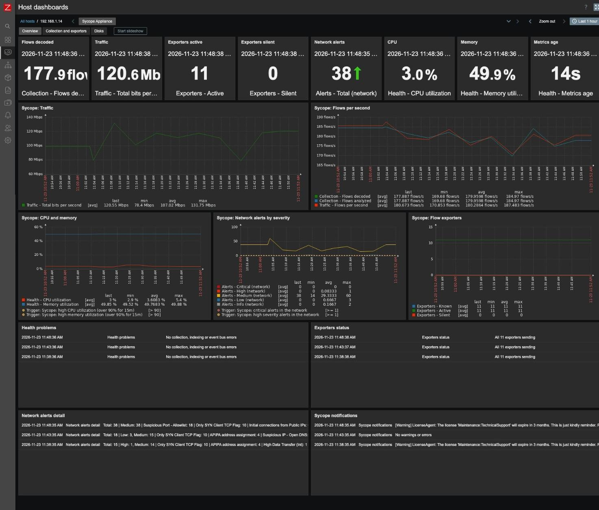

# Zabbix Integration with Sycope

This directory contains two complementary integrations between Zabbix and Sycope, covering both directions of data flow.

- **Zabbix → Sycope:** scripts that send Zabbix monitoring statistics and inventory data to a custom index and a dedicated Lookup in Sycope.
- **Sycope → Zabbix:** a Zabbix template that shows Sycope statistics and alerts in Zabbix.

> **Sycope is available as a [free version](https://free.sycope.com/)** supporting up to 5,000 flows/second with no limitations on data sources, subnetworks, or number of monitored hosts. The free version includes threat detection, anomaly detection, and personalized dashboards — making it viable for production use without a license cost. The main differences vs. the paid version are data retention (14 days vs. unlimited), access management (single admin role vs. full RBAC), and probes monitoring availability.

## Zabbix Statistics & Inventory Sync

**Direction: Zabbix → Sycope**

This integration enables sending monitoring statistics and inventory data from Zabbix to a custom index and dedicated Lookup in **Sycope** for further correlation, search, and visualization.

An example of the Zabbix Statistics Dashboard


An example of the Zabbix Inventory Dashboard


---

## Sycope Monitoring Template for Zabbix

**Direction: Sycope → Zabbix**

Bring Sycope's network visibility, security alerts, and asset discovery data directly into Zabbix — without any additional middleware, lookup services, or data pipeline. The template uses only the **Sycope REST API and NQL** to query traffic and alert data for each monitored host.

This means you get Sycope's deep network intelligence — scan detection, anomaly alerts, passive port discovery, connection profiling — surfaced as native Zabbix items, triggers, graphs, and dashboards, fully integrated with your existing Zabbix monitoring workflow.

### What's included

- **33 monitoring items** per host covering security alerts, performance, visibility, asset discovery, and active alert severity breakdown, fed by 4 master items (6 NQL queries per host and cycle)
- **Sycope Appliance template** for Sycope itself, without IP filtering: appliance CPU/memory/disks, flow reception and decoding, indexing, flow exporters (discovered), total traffic, all alerts in the network and system notifications such as license expiry
- **Built-in graphs** with trigger threshold lines for Security Alerts, Performance Alerts, Connections, Matched IPs, and Active Services
- **Triggers** with configurable WARNING and HIGH thresholds, plus DISASTER trigger for critical severity alerts
- **Multi-host dashboard** importable via Zabbix API script
- **No agent, no SNMP, no port scanning** — all data is collected passively via NQL queries

### Screenshots

**All Sycope monitoring items collected per host, tagged and filterable by `source: sycope`:**


**Custom dashboard with live security KPIs, alert graphs, connection trends, and performance monitoring:**


**Sycope Appliance template dashboard: health of the Sycope appliance, flow collection, exporters and alerts in the whole network:**



See [template folder](https://github.com/SycopeSolutions/Integrations/tree/main/zabbix/template) for full documentation.

---

## Components

The integrations consists of :

1. **Sycope** - Receives data through the REST API
2. **Zabbix** - Provides statistics and inventory data using active monitoring and REST API
3. **Integration Scripts** - Python-based scripts for synchronizing all the data from Zabbix to Sycope
4. **Dashboards** - Ready to use dashboards for presenting data from Zabbix in Sycope
5. **Fields** - Custom fields for different Zabbix inventory data used in Sycope
6. **Drilldowns** - Ad hoc drilldown actions for Sycope such as hyperlinks and inventory data

> **Scripts can be executed on the same host as Zabbix. Due to permissions and other limitations, please do not run them on Sycope Appliance.**

---

## How the Integrations works

The `zabbix_statistics.py` script:

- Logs in to the Zabbix API and collects metrics for defined IP addresses
- Aligns timestamps for different metrics - `CPU Load, ICMP Reponse Time, Memory Usage and Packet Loss`
- Compares gathered metric with already available metrics in Sycope's custom index to avoid duplicate samples (one sample per IP and minute)
- Saves the difference in Sycope. A minute is saved when at least one metric has a value, so hosts without the ICMP template (or without a memory item) still get samples; the missing metrics stay empty
- Fills the gaps of items with *Discard unchanged* preprocessing: Zabbix stores their value only when it changes or once per heartbeat, so on an idle host most minutes have no history. The last stored value is used until the heartbeat (without a heartbeat: up to `max_value_age_minutes`, default 60)
- Picks the items by ordered key rules (first match wins), so the common Zabbix templates work without configuration:

  | Metric | Item keys, in order | Several items (one per CPU / memory pool) |
  |---|---|---|
  | `cpu_load` | `system.cpu.util` (Windows/Linux agent), `system.cpu.util[snmp,*]` (Linux SNMP), `system.cpu.util[cpmCPUTotal5minRev.*]` (Cisco), `system.cpu.util[hrProcessorLoad.*]` (HOST-RESOURCES-MIB) | average |
  | `memory_usage` | `vm.memory.util` (Windows agent), `vm.memory.utilization` (Linux agent), `vm.memory.util[snmp]` (Linux SNMP), `vm.memory.util[*]` (Cisco and other pools) | the *Processor* pool (item name `Processor: ...`), otherwise the fullest pool |
  | `response_time`, `packet_loss` | `icmppingsec`, `icmppingloss` (with or without parameters) | average |

  `system.cpu.load` (load average) is not CPU utilization in percent and is not used. Other templates: set `item_keys` in `config.json`
- Hostname: inventory *Name*, then inventory *Hostname*, then the host's visible name, then its technical host name - the same as `zabbix_lookup_sync.py`. Host inventory does not have to be enabled

- Reads Zabbix with a few bulk requests per run (one `host.get`, one `item.get`, `history.get` per value type), so the number of requests does not grow with the number of hosts; float and unsigned items are both supported
- Uses only enabled hosts and items. When several enabled hosts share an IP, the first one is used (logged at debug level)

The `zabbix_lookup_sync.py` script:

- Logs in to the Zabbix API and collects inventory data such as Hostname, OS version, Serial number, Notes and URLs for every host with an interface (one `host.get` and one `item.get` per run)
- Host type and IP come from the first interface found in the order SNMP, Zabbix agent, JMX, IPMI (main interface first); the `host_type` column is `SNMP`, `Agent`, `JMX` or `IPMI`. Versions up to 2.0 labelled agent hosts as `ICMP`
- Compares gathered inventory data with already available custom Lookup to avoid duplicate records
- Saves the difference in Sycope

---

## Repository Content

```
.
├── template/               # Sycope Monitoring Template for Zabbix (Sycope → Zabbix)
│   ├── sycope_check.py              # External check script for Zabbix
│   ├── zbx_sycope_monitoring.yaml   # template per monitored host, Zabbix 7.0+ (also imports into Zabbix 8.0)
│   └── zbx_sycope_appliance.yaml    # template for the Sycope appliance itself (no IP filter)
├── dashboards                       # Optional dashboards to import into Sycope
├── drilldowns                       # Optional drilldown action to import into Sycope
├── fields                           # Optional custom fields to import into Sycope
├── config.json                      # Configuration file
├── install.py                       # Creates the custom index, imports fields, drilldowns and dashboards
├── uninstall.py                     # Optional cleanup for custom indexes and custom Lookups
├── zabbix_statistics.py             # Main processing script for synchronizing metrics data
├── zabbix_lookup_sync.py            # Main processing script for synchronizing inventory data
├── zabbix_api.py                    # Zabbix API client shared by both scripts
└── tests/                           # Tests with a fake Zabbix API and a fake Sycope NQL API: python3 -m pytest zabbix/tests
```

---

## Requirements

- Python 3.8+
- Zabbix 7.0+, including Zabbix 8.0 (the API client sends the session or token in the `Authorization` header, available since Zabbix 6.4)
- Sycope >= 3.1 with API access
- Tested with Zabbix 7.0.5 and 8.0.0, Sycope 3.3.1, Python 3.10 and 3.15, polars 1.32 and 2.1
- `requests` module:
  ```bash
  pip3 install requests
  ```
- `polars` module:
  ```bash
  pip3 install polars
  ```
  
---

##  User & Role Setup in Sycope

After creating new index, add a dedicated user and role in Sycope for log ingestion:

1. **Create a Role**  
   Go to **Configuration → Roles**, create a role (e.g., `ZabbixInject`) with:
   - Permission to inject data only into custom indexes

2. **Create a User**  
   Go to **Configuration → Users**, create a user (e.g., `zabbix_ingestor`) and assign the above role.

---

##  Installation

```bash
git clone https://github.com/SycopeSolutions/Integrations.git
cd Integrations/zabbix
pip3 install -r requirements.txt
# edit config.json (see below)
python3 install.py --dry-run     # shows what would be created or updated, changes nothing
python3 install.py               # Sycope 3.3
python3 install.py --sycope-3.2  # Sycope 3.2 (legacy): dashboards converted to the 3.2 format first
```

`install.py` creates the `ZabbixStats` index (an existing index is left unchanged), then imports through the API the saved fields (`fields/`), the drilldown widget and shortcut (`drilldowns/`) and the dashboards (`dashboards/`). Objects are matched by name, so running it again updates them in place. Options: `--skip-fields`, `--skip-drilldowns`, `--skip-dashboards`.

---

##  Configuration (`config.json`)

```jsonc
{
    // URL of the Zabbix API endpoint (HTTPS strongly recommended)
    "zabbix_host": "https://zabbix.example.com",

    // Additional part of the Zabbix API endpoint
    "zabbix_api_base": "/api_jsonrpc.php",

    // Zabbix API token (recommended): Users -> API tokens. With a token the scripts do not log in
    // and out, so no Zabbix session is opened per run; zabbix_login/zabbix_pass are then not needed.
    // The token's user needs read access to the monitored hosts.
    "zabbix_token": "",

    // Or a Zabbix API user and password (a session per run, closed with user.logout)
    "zabbix_login": "Admin",
    "zabbix_pass": "",

    // Optional: Zabbix request timeout in seconds (default 60) and TLS certificate check (default false)
    "zabbix_timeout": 60,
    "zabbix_verify_ssl": false,

    // URL of the Sycope API endpoint (HTTPS strongly recommended)
    "sycope_host": "https://sycope.example.com",

    // Additional part of the Sycope API endpoint
    "api_base": "/npm/api/v1/",

    // Sycope API user (must have rights to inject data into custom indexes)
    "sycope_login": "admin",

    // Password for the above API user
    "sycope_pass": "",

    // Name of the Lookup in Sucope (for inventory data synchronization)
    "lookup_name": "integration-zabbix",

    // Name of the custom index defined in Sycope (for statistics)
    "index_name": "ZabbixStats",

    // Custom index rotation
    "index_rotation": "daily",

    // Custom index time period (amount of data to be synchronized)
    // Script will check for duplicate data and will not save it twice
    "period_minutes": 120,

    // Optional (default 60): how long the last value of a "Discard unchanged" item without a
    // heartbeat is used for the following minutes. Items with a heartbeat use the heartbeat.
    "max_value_age_minutes": 60,

    // Optional: replace the item rules of a metric (cpu_load, memory_usage, response_time,
    // packet_loss). A rule is a key pattern ("*" = any text) or an object with "key",
    // "aggregate" ("avg" or "max") and "prefer_name". The first rule that matches wins.
    "item_keys": {
      "cpu_load": ["system.cpu.util", {"key": "system.cpu.util[hrProcessorLoad.*]", "aggregate": "max"}]
    },

    // Examples for IPs to be synchronized
    // The Zabbix API is quite fast, allowing you to synchronize all IPs;
    // however, it may be wise to consider limiting them for efficiency or control.
    "target_ips": [
      "192.0.2.1",
      "192.0.2.2"
    ]
}

```

>  JSON does not support comments natively — this format is shown for documentation purposes only. Use a standard `config.json` file without comments in production.

---

##  Script Usage

| Script                    | Purpose                                    | Example                                             |
|---------------------------|--------------------------------------------|-----------------------------------------------------|
| **install.py**            | Create index, import fields, drilldowns and dashboards | `python3 install.py [--sycope-3.2]`       |
| **zabbix_lookup_sync.py** | Synchronization of the Inventory data      | `python3 zabbix_lookup_sync.py` (e.g., via systemd) |
| **zabbix_statistics.py**  | Synchronization of the Statistics data     | `python3 zabbix_statistics.py` (e.g., via systemd)  |

---

##  Running the Script

Run manually:
```bash
python3 zabbix_lookup_sync.py
python3 zabbix_statistics.py
```
Or run as a service (recommended)

---

##  Notes

- A run of a script that starts while the previous run of the same script is still working is skipped
  (lock files `zabbix_statistics.lock` and `zabbix_lookup_sync.lock` next to the scripts), so cron runs
  every minute never overlap or save the same minutes twice.
- Versions up to 2.1 of the statistics script and 2.0 of the lookup script did not close their Zabbix
  sessions. With a run every minute Zabbix keeps over 500,000 open sessions for the API user until its
  housekeeper removes them after a year. Use an API token, or check the `sessions` table after upgrading.

- The script requires a valid custom index in Sycope with matching column definitions.
- Running the script on the Sycope appliance is not supported due to security isolation.
- Each index in Sycope has a **retention period**. Set it in **Settings → Indices → Retention** according to your storage policy.

---

##  Dashboard Import

`install.py` imports the dashboards, fields and drilldowns. The steps below are only needed for a manual import from the GUI.

1. In Sycope UI, go to **Dashboards → Add dashboard ▾ → Import dashboard**
2. Upload `dashboards/zabbix_statistics_dashboard.json`, click **Save and close**
3. Repeat for `dashboards/zabbix_inventory.json`

**Sycope 3.2 (legacy):** the files use the Sycope 3.3 export format. Convert them first, then import the converted files from the GUI. Run the command from the repository root:

```bash
python3 -m sycope.scripts.convert_dashboard --to 3.2 zabbix/dashboards/*.json -o zabbix/dashboards-3.2
```

Then import the files from `zabbix/dashboards-3.2/`.

##  Fields Import

1. In Sycope UI, go to **Settings → Objects → Fields → Add field ▾ → Import field**
2. Upload a file from `fields/` (for example `field_zabbix_graph_url.json`). The field opens in the editor; click **Save**.
3. Repeat for the other files in `fields/`

##  Drilldown Import

Import the widget first, because the shortcut points to it:

1. **Configuration → Widgets → Add widget ▾ → Import widget**: upload `drilldowns/zabbix_inventory_drilldown_widget.json` and save it
2. **Configuration → Shortcuts → Add shortcut ▾ → Import shortcut**: upload `drilldowns/zabbix_inventory_drilldown_action.json`, check that **Widget** is set to *Zabbix Inventory - Drilldown*, and save it

The field, widget and shortcut files work in Sycope 3.2 and 3.3 without conversion. GUI import was checked on 3.3.1.

---

## Troubleshooting

If you encounter any issues while running the integration scripts, enable debug logging to get more detailed information:

1. Open the `config.json` file
2. Change the `log_level` setting from `"info"` to `"debug"`:
   ```json
   {
     "log_level": "debug",
     ...
   }
   ```
3. Run the script again and review the detailed output in the log file (e.g., `zabbix_statistics.log` or `zabbix_lookup_sync.log`)

---

## Notice

This integration **does not install or configure Zabbix for you**.
You must install, configure, and run Zabbix **independently**.
The provided Python scripts are intended **only for integrating** Zabbix data with **Sycope** using its REST API.
