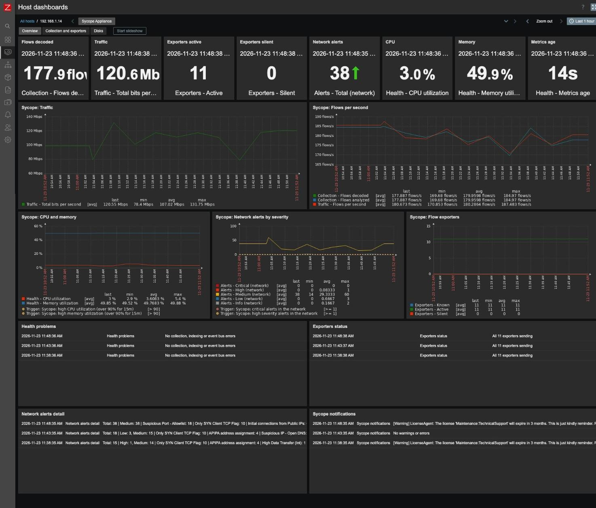
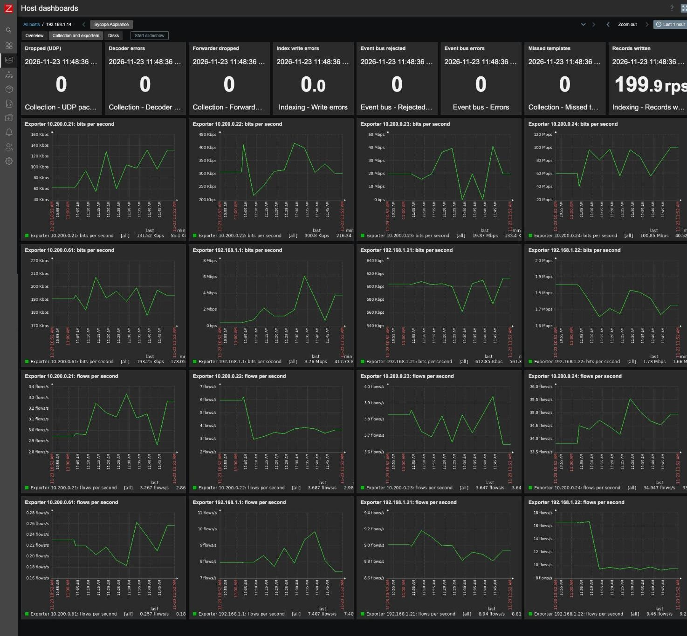
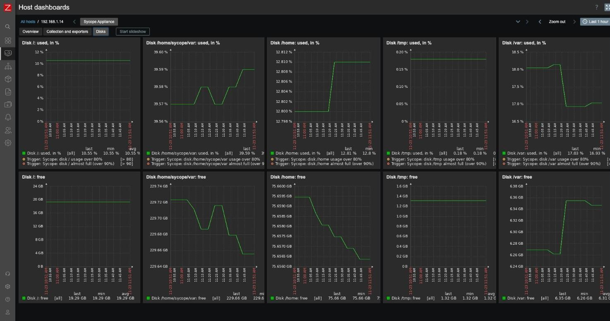

# Zabbix Template for Sycope Monitoring

Zabbix external check integration for the **Sycope NTA/Security Analytics** platform.

Sycope collects and analyzes network flow data, providing visibility into traffic patterns, asset discovery, and security alerts. This integration brings that data into Zabbix by querying the Sycope REST API using NQL (Network Query Language) — the same query language used natively in the Sycope UI.

There are two templates:

- **Sycope Monitoring** — linked to the monitored servers. For each host the script runs NQL queries filtered by the host's IP address (alerts, active services, traffic policies, connections). Zabbix collects them via external checks every 5 minutes and evaluates them against configurable thresholds.
- **Sycope Appliance** — linked to the one host that represents the Sycope appliance. It monitors Sycope itself and the whole network without any IP filter: CPU, memory and disks of the appliance, flow reception and decoding, indexing, flow exporters, total traffic, all alerts in the network and Sycope system notifications. See [Sycope Appliance template](#sycope-appliance-template).

Both templates use one external-check **master item** per check (raw JSON) and **dependent items** that read single values from it, so one run of the script feeds many items.

> **Sycope is available as a [free version](https://free.sycope.com/)** supporting up to 5,000 flows/second with no limitations on data sources, subnetworks, or number of monitored hosts. The free version includes threat detection, anomaly detection, and personalized dashboards — making it viable for production use without a license cost. The main differences vs. the paid version are data retention (14 days vs. unlimited), access management (single admin role vs. full RBAC), and performance monitoring availability.

---

## Files

| File | Description |
|---|---|
| `sycope_check.py` | External check script — place in Zabbix ExternalScripts directory |
| `zbx_sycope_monitoring.yaml` | Template **Sycope Monitoring** (per monitored host), Zabbix 7.0+ (Zabbix 8.0 included) |
| `zbx_sycope_appliance.yaml` | Template **Sycope Appliance** (the Sycope appliance itself, no IP filter), Zabbix 7.0+ |

---

## Requirements

- Zabbix 7.0+, including Zabbix 8.0
- Python 3.8+ on the Zabbix server/proxy
- Sycope 3.x with REST API accessible from the Zabbix server
- Tested with Zabbix 7.0.5 and Sycope 3.3.1; the template import was also checked on Zabbix 8.0.0
- Zabbix server must be able to reach Sycope on HTTPS (port 443)

---

## Installation

### 1. Deploy the script

```bash
cp sycope_check.py /usr/lib/zabbix/externalscripts/sycope_check.py
chmod 755 /usr/lib/zabbix/externalscripts/sycope_check.py
chown zabbix:zabbix /usr/lib/zabbix/externalscripts/sycope_check.py
```

### 2. Configure credentials

The script reads credentials from `/etc/zabbix/sycope.conf` (preferred) or environment variables.

**Option A — Config file (recommended)**

```bash
cat > /etc/zabbix/sycope.conf << 'EOF'
SYCOPE_USER=admin
SYCOPE_PASSWORD=yourpassword
EOF

chmod 640 /etc/zabbix/sycope.conf
chown root:zabbix /etc/zabbix/sycope.conf
```

The config file uses plain `KEY=VALUE` format. Lines starting with `#` are ignored. Values can optionally be quoted.

**Option B — Environment variables**

Set before running or in the Zabbix server's systemd environment:

```bash
export SYCOPE_USER=admin
export SYCOPE_PASSWORD=yourpassword
```

**Option C — Inline for testing only**

```bash
SYCOPE_USER=admin SYCOPE_PASSWORD=yourpassword python3 sycope_check.py ...
```

> **Note:** The config file is read at script startup via `load_config_file()`. Environment variables set before the script runs take precedence over the config file (`os.environ.setdefault` is used, so existing env vars are never overwritten).

**Session reuse (version 1.1)**

All checks share one Sycope session instead of logging in and out on every check. This saves a login per check and keeps checks within the Zabbix `Timeout`. The session cookie is cached in a file readable only by the Zabbix user. When Sycope invalidates the session (for example after a restart), the script logs in again and repeats the check once.

Optional settings, in `/etc/zabbix/sycope.conf` or the environment:

| Setting | Default | Description |
|---|---|---|
| `SYCOPE_SESSION_TTL` | `600` | Seconds a session is reused. `0` restores the version 1.0 behaviour (log in and out on every check). |
| `SYCOPE_SESSION_DIR` | system temp directory | Directory of the cache file `sycope_check_<hash>.session`. Must be writable by the Zabbix user. |
| `SYCOPE_HTTP_TIMEOUT` | `5` | Seconds to wait for each Sycope API response (version 1.2+). A stalled appliance then fails the check with an error instead of running into the Zabbix item timeout. |

If the credentials are wrong, every item returns `{"error": "Sycope login failed (HTTP 400) Invalid username or password."}`. The items then hold `-1` (or `error`) and the trigger **Sycope: checks failing on {HOST.NAME}** opens (see [Failing checks](#failing-checks)).

### 3. Import the Zabbix template

In Zabbix: **Data Collection → Templates → Import**

- Browse to `zbx_sycope_monitoring.yaml` (and `zbx_sycope_appliance.yaml` for the appliance template)
- Check **Update existing** if re-importing after changes
- Click **Import**

> **Upgrading from 1.x:** deploy `sycope_check.py` 2.0 (step 1) before importing the 2.0 template, because the master items use the new check type `host_alerts`. The import keeps the item IDs (items are matched by UUID), so the history of all 33 items is kept although they become dependent items with new keys (for example `sycope.alert.count["Horizontal Scan"]`).

> **Upgrading:** an import with **Update existing** sets the template macros back to the values in the file, for example `{$SYCOPE_IP}` to `sycope.example.com`. Set `{$SYCOPE_IP}` and any other changed macro on the hosts (step 4) or as a global macro (**Administration → Macros**), not on the template, so that a new template version keeps them. If you changed them on the template, set them again after the import. A wrong `{$SYCOPE_IP}` makes every check fail and opens the *checks failing* trigger.

### 4. Assign the template to hosts

1. Go to **Data Collection → Hosts → [host] → Templates**
2. Add **Sycope Monitoring**
3. Go to the **Macros** tab and set `{$SYCOPE_IP}` to your Sycope appliance IP
4. Click **Update**

> The script uses `{HOST.IP}` automatically as the monitored IP for all NQL queries — no manual configuration needed per host beyond the `{$SYCOPE_IP}` macro.

### 5. Link the appliance template to the Sycope host (optional)

Create a host for the Sycope appliance (or use an existing one, for example with the *ICMP Ping* template) whose main interface has the Sycope address, and add the template **Sycope Appliance**. Its checks use `{HOST.CONN}` (the main interface) as the Sycope API address, so it needs no `{$SYCOPE_IP}` macro.

---

## Zabbix Macros

All macros can be overridden per-host via **Data Collection → Hosts → [host] → Macros → Inherited and host macros**.

| Macro | Default | Description |
|---|---|---|
| `{$SYCOPE_IP}` | `sycope.example.com` | IP or hostname of the Sycope appliance |
| `{$SYCOPE_ALERT_MINUTES}` | `15` | Lookback window (minutes) for all alert queries |
| `{$SYCOPE_ASSET_DAYS}` | `7` | Lookback window (days) for active services discovery |
| `{$SYCOPE_SKIP_NAT_PORTS}` | `true` | Active services: ignore server ports 49152 and above (ephemeral/NAT ports) |
| `{$SYCOPE_ASSET_DELAY}` | `1h` | Active services: check interval. The query covers `{$SYCOPE_ASSET_DAYS}` days of traffic, so a shorter interval adds load without new information |
| `{$SYCOPE_MATCHED_MINUTES}` | `60` | Lookback window (minutes) for matched/unmatched IP queries |
| `{$SYCOPE_CONN_MINUTES}` | `30` | Lookback window (minutes) for connection count queries |
| `{$SYCOPE_ALERT_WARN}` | `1` | Alert count threshold for WARNING trigger |
| `{$SYCOPE_ALERT_HIGH}` | `5` | Alert count threshold for HIGH trigger |
| `{$SYCOPE_ERROR_PERIOD}` | `15m` | *Checks failing* trigger: period in which every connections check returned an error |
| `{$SYCOPE_NODATA_PERIOD}` | `30m` | *Checks failing* trigger: period without any connections check result |
| `{$SYCOPE_TIMEOUT}` | `20s` | Timeout of every check item (Zabbix 7.0+ item timeout); overrides the Zabbix server `Timeout` |

### Failing checks

A failed check (wrong credentials, Sycope unreachable, API error, wrong `{$SYCOPE_IP}`) does not make the items unsupported: the master item stores the script's `{"error": "..."}` JSON (kept for 1 day in the `(raw)` items) and the dependent items store `-1` (counts) or `error` (messages) so that the item history shows when it happened. The other Sycope triggers cannot fire on such values, so the template has one availability trigger per host:

| Trigger | Expression (on the *Private Connections From Node* item) | Severity |
|---|---|---|
| Sycope: checks failing on {HOST.NAME} | every value in `{$SYCOPE_ERROR_PERIOD}` is `-1`, or no value in `{$SYCOPE_NODATA_PERIOD}` | AVERAGE |

To see the error, run the check as the Zabbix user, for example
`sudo -u zabbix /usr/lib/zabbix/externalscripts/sycope_check.py <sycope_ip> connections <host_ip> 30`.
The template **Sycope Appliance** has the same trigger, *Sycope: API checks failing*, on its CPU utilization item.

> **Tip:** Performance latency alerts (`High Server/Client Network Latency`) tend to be infrequent. If those items always show 0, increase `{$SYCOPE_ALERT_MINUTES}` to `1440` (24 hours) on the host level.

---

## Check Types

The script supports the following check types, passed as the second argument:

| Check type | Extra args | NQL queries | Description |
|---|---|---|---|
| `host_alerts` | `<minutes> [alert_name...]` | 1 | All alerts of the host: total, severity counts, per-alert-name counts (`by_name`) |
| `active_services` | `<days> <disable_nat_ports>` | 1 | Active server ports seen on the host |
| `matched_ips` | `<minutes>` | 2 | Matched/unmatched client/server IP counts |
| `connections` | `<minutes>` | 2 | Inbound/outbound connection counts |
| `appliance_health` | `<minutes>` | 3-4 | Sycope self-monitoring (`metrics` stream); `<monitored_ip>` is `-` |
| `appliance_traffic` | `<minutes> <exporter_hours>` | 3 | Total traffic and flow exporters; `<monitored_ip>` is `-` |
| `appliance_alerts` | `<minutes>` | 2 | Alerts in the whole network and system notifications; `<monitored_ip>` is `-` |
| `alert_count` | `<alert_name> <include_client> <minutes>` | 1 | 1.x: count of one named alert (not used by the 2.0 template) |
| `any_alerts` | `<minutes>` | 1 | 1.x: all alerts of the host with severity counts (not used by the 2.0 template) |

All check types return a JSON object. The template has one master item (external check, `(raw)` in the name) per check and host; the other items are dependent items that extract single values with JSONPath (or a short JavaScript step for the alert-name items).

**Queries per host and 5-minute cycle:** 5, plus 1 per hour for active services (version 1.x: about 93, because each of the 33 items ran its check separately and each `matched_ips` item ran all 8 queries).

---

## Template Items

### Visibility
| Item | Key field | Trigger |
|---|---|---|
| Only SYN Client TCP Flag | `$.value` | WARNING > 1, HIGH > 5 |
| Initial Connections from Public IPs | `$.value` | HIGH > 5 |

### Security
| Item | Key field | Trigger |
|---|---|---|
| Horizontal Scan | `$.value` | WARNING > 1, HIGH > 5 |
| Vertical Scan | `$.value` | WARNING > 1, HIGH > 5 |

### Performance
| Item | Key field | Trigger |
|---|---|---|
| High Server Network Latency | `$.value` | WARNING > 1 |
| High Client Network Latency | `$.value` | WARNING > 1 |

### Sycope - Active Alerts
| Item | Key field | Trigger |
|---|---|---|
| Active Alerts (total) | `$.value` | WARNING > 1, HIGH > 5 |
| Active Alerts (critical) | `$.severity_critical` | DISASTER ≥ 1 |
| Active Alerts (high) | `$.severity_high` | HIGH ≥ 1 |
| Active Alerts (medium) | `$.severity_medium` | — |
| Active Alerts (low) | `$.severity_low` | — |
| Active Alerts (info) | `$.severity_info` | — |
| Active Alerts (detail) | `$.message` | — |

### Asset Discovery
| Item | Description |
|---|---|
| Active Services (count) | Number of unique server ports active in last `{$SYCOPE_ASSET_DAYS}` days |
| Active Services (port list) | Port numbers with application names, e.g. `22 (SSH), 443 (HTTPS)` |
| Matched/Unmatched Client/Server Public/Private IPs | 8 distinct counters |
| Private/Public Connections From/To Node | 4 distinct counters |

All items are tagged with `source: sycope` and a `component` tag for easy filtering in Zabbix Latest Data. The four master items `Sycope - ... (raw)` (tag `type: raw`) hold the JSON of each check.

> The four *Matched/Unmatched Server ... IPs* items can only be 0 or 1: the queries filter `serverIp = {HOST.IP}`, so there is a single server address. They show whether the host served traffic that matches (or does not match) the traffic profiles, as a public or a private address.

---

## Testing

Test the script manually on the Zabbix server. Always use the actual host IP as the third argument.

**Basic connectivity — all alerts with severity breakdown:**
```bash
SYCOPE_USER=admin SYCOPE_PASSWORD=yourpassword \
  python3 /usr/lib/zabbix/externalscripts/sycope_check.py \
  sycope.example.com any_alerts 10.0.0.5 15
```

Expected output:
```json
{
  "value": 8,
  "severity_critical": 0,
  "severity_high": 0,
  "severity_medium": 8,
  "severity_low": 0,
  "severity_info": 0,
  "message": "Total: 8 | Medium: 8 | Only SYN Client TCP Flag [Medium]: 7 | Unauthorized LLMNR/NetBIOS Activity [Medium]: 1"
}
```

**Specific named alert:**
```bash
SYCOPE_USER=admin SYCOPE_PASSWORD=yourpassword \
  python3 /usr/lib/zabbix/externalscripts/sycope_check.py \
  sycope.example.com alert_count 10.0.0.5 "Horizontal Scan" true 15
```

**Wider time window for infrequent alerts (24 hours):**
```bash
SYCOPE_USER=admin SYCOPE_PASSWORD=yourpassword \
  python3 /usr/lib/zabbix/externalscripts/sycope_check.py \
  sycope.example.com alert_count 10.0.0.5 "High Server Network Latency" true 1440
```

**Active services discovery:**
```bash
SYCOPE_USER=admin SYCOPE_PASSWORD=yourpassword \
  python3 /usr/lib/zabbix/externalscripts/sycope_check.py \
  sycope.example.com active_services 10.0.0.5 7 true
```

**Connection counts:**
```bash
SYCOPE_USER=admin SYCOPE_PASSWORD=yourpassword \
  python3 /usr/lib/zabbix/externalscripts/sycope_check.py \
  sycope.example.com connections 10.0.0.5 30
```

**Common error responses:**

| Output | Cause |
|---|---|
| `{"error": "SYCOPE_USER or SYCOPE_PASSWORD env vars not set"}` | Config file missing or not readable by zabbix user |
| `{"error": "...SSL..."}` | Certificate issue — SSL verification is disabled by default, check network connectivity |
| `{"value": 0, "message": "Total: 0..."}` | No alerts in time window — try wider window |
| `{"error": "Unknown check_type: ..."}` | Typo in check type argument |

---

## Adding or Modifying NQL Queries

All NQL queries are contained in the `check_*` functions in `sycope_check.py`. Each function follows the same pattern:

1. Build timestamps with `make_timestamps()`
2. Construct the NQL string
3. Call `run_nql()` which handles job polling and pagination automatically
4. Process results and return a dict with at minimum a `value` key

**Example: Adding a check for a new alert type**

The simplest approach requires no code changes — use the existing `alert_count` check type with the alert name as an argument. First discover what alert names exist on a host:

```bash
SYCOPE_USER=admin SYCOPE_PASSWORD=yourpassword \
  python3 sycope_check.py sycope.example.com any_alerts 10.0.0.5 1440
```

This returns all alert names seen in the last 24 hours. Once you have the exact name, add it as a dependent item of the master item `Sycope - Host alerts (raw)` in `zbx_sycope_monitoring.yaml` (the master item already returns every alert name of the host, no change of the master item is needed):

```yaml
- uuid: <generate: python3 -c "import uuid; print(uuid.uuid4().hex)">
  name: 'Security - DNS Tunneling'
  type: DEPENDENT
  key: 'sycope.alert.count["DNS Tunneling"]'
  delay: '0'
  history: 7d
  trends: '0'
  value_type: FLOAT
  preprocessing:
    - type: JAVASCRIPT
      parameters:
        - |
          var d = JSON.parse(value);
          if (d.error) {
              throw d.error;
          }
          var e = (d.by_name || {})["DNS Tunneling"];
          return e ? e.value : 0;
      error_handler: CUSTOM_VALUE
      error_handler_params: '-1'
  master_item:
    key: 'sycope_check.py["{$SYCOPE_IP}","host_alerts","{HOST.IP}","{$SYCOPE_ALERT_MINUTES}"]'
  tags:
    - tag: component
      value: security
    - tag: source
      value: sycope
  triggers:
    - uuid: <generate new uuid>
      expression: 'last(/Sycope Monitoring/sycope.alert.count["DNS Tunneling"])>=1'
      name: 'Sycope: DNS Tunneling detected on {HOST.NAME}'
      priority: HIGH
```

The JavaScript step returns 0 when the alert did not occur in the window and `-1` (error handler) when the check failed.

**Example: Custom NQL query in the script**

To add a completely new check type — for example counting unique external IPs communicating with a host — add a new function to `sycope_check.py`:

```python
def check_unique_external_ips(base_url, cookie, ip, last_minutes):
    start_time, end_time = make_timestamps(minutes_back=last_minutes)
    nql = (
        f'src stream="assetNetflowAggr" | serverIp = "{ip}" | '
        f'set privacy=lookup("hosts & subnets", "privacy", {{"cidr": clientIp}}) | '
        f'privacy != "Private" | '
        f'aggr unique_ips=dc(clientIp) unwind=true | limit 1'
    )
    rows = run_nql(base_url, cookie, nql, start_time, end_time)
    count = int(rows[0].get("unique_ips", 0)) if rows else 0
    return {"value": count, "message": f"Unique external IPs: {count}"}
```

Then register it in `run_check()` before the `else` clause:

```python
elif check_type == "unique_external_ips":
    last_minutes = int(extra[0]) if len(extra) > 0 else 60
    return check_unique_external_ips(base_url, cookie, monitored_ip, last_minutes)
```

Key rules when writing NQL queries:
- Use f-strings when embedding the `ip` variable: `f'... serverIp = "{ip}" ...'`
- Always call `make_timestamps()` for consistent time window handling
- Use `run_nql()` — it handles job ID polling and result pagination automatically
- Always return a dict with at least a `value` key (numeric) so Zabbix can graph it

---

## Disabling Checks for Unlicensed Modules

Sycope is modular — not all installations include every module. If a module is not licensed or enabled, the corresponding NQL queries will return empty results and items will show `0` or `error`. To avoid noise, disable the relevant items on the host.

### Which items belong to which module

| Sycope Module | Template Items |
|---|---|
| **Visibility** | Visibility, Sycope - Active Alerts |
| **Asset Discovery** | Asset Discovery - Active Services, Matched/Unmatched IPs, Connections From/To Node |
| **Performance** | Performance - High Server/Client Network Latency |
| **Security** | Security - Horizontal Scan/Vertical Scan |

### How to disable items in Zabbix

**Per host (recommended)** — disables items only on a specific host without affecting others:

1. Go to **Data Collection → Hosts → [host] → Items**
2. Filter by `sycope` in the search box
3. Select all items you want to disable
4. Click **Mass update → Status → Disabled**

**Per template** — disables items for all hosts using the template:

1. Go to **Data Collection → Templates → Sycope Monitoring → Items**
2. Select the items to disable
3. Click **Mass update → Status → Disabled**

> **Note:** Disabled items are not collected and do not trigger alerts, but they remain in the template and can be re-enabled at any time.

### Disabling entire item groups by tag

Since all items have a `component` tag, you can filter and bulk-disable by component:

1. Go to **Data Collection → Hosts → [host] → Items**
2. Use the **Tags** filter: `component = asset_discovery`
3. Select all → **Mass update → Status → Disabled**

Component tag values used in this template:

| Tag value | Items |
|---|---|
| `visibility` | Only SYN TCP Flag, Initial connections from Public IPs |
| `security` | Horizontal Scan, Vertical Scan |
| `performance` | High Server/Client Network Latency |
| `alerts` | Sycope - Active Alerts (all severity items) |
| `asset_discovery` | Active Services, Matched/Unmatched IPs, Connections |

## Sycope Appliance template

Template **Sycope Appliance** (`zbx_sycope_appliance.yaml`) monitors the Sycope appliance and the whole network, without filtering by IP. Link it to the host that represents Sycope; the checks use `{HOST.CONN}` as the API address.

| Master item (raw) | Check | Source in Sycope | Dependent items |
|---|---|---|---|
| Sycope - Health (raw) | `appliance_health` | `metrics` stream (Sycope self-monitoring) | CPU and memory utilization, memory total/used, metrics age, flow packets received, flows decoded/analyzed/filtered, missed templates, dropped packets and errors of the listeners, decoder and forwarder, indexing writes and errors, event bus rejected/dead/errors/queue, syslog/Ambience input errors, failed DNS servers, problems summary |
| Sycope - Traffic (raw) | `appliance_traffic` | `netflowTotalAggr`, `netflowByExporterAggr` | Total bps, pps, flows/s, sessions/s; exporters active/known/silent and status |
| Sycope - Alerts (raw) | `appliance_alerts` | `alerts`, `notifications` | Network alerts total and per severity, distinct alert names, top-10 detail; system notifications per level (for example license expiry warnings) with detail |

Low-level discovery (dependent rules, no extra queries):

- **Sycope disks** — `{#DISK}`: total, used, free, used in % for each file system of the appliance
- **Sycope flow exporters** — `{#EXPORTER}`: bps, pps, flows/s and *sending* (1/0) for each exporter seen in the last `{$SYCOPE_EXPORTER_HOURS}` hours

Rates are averages over the last `{$SYCOPE_WINDOW_MINUTES}` whole minutes (the current, incomplete minute is left out).

| Trigger | Severity |
|---|---|
| Sycope: API checks failing on {HOST.NAME} | AVERAGE |
| Sycope: self-monitoring metrics not written for over `{$SYCOPE_METRICS_AGE_MAX}`s | HIGH |
| Sycope: no flows received for 15m (decoded flows/s below `{$SYCOPE_FLOWS_MIN}`) | HIGH |
| Sycope: exporter {#EXPORTER} stopped sending flows (none for `{$SYCOPE_EXPORTER_SILENT}`) | AVERAGE |
| Sycope: flow packets dropped or not decoded | WARNING |
| Sycope: index write or delete errors | WARNING |
| Sycope: internal processing errors (event bus, inputs) | WARNING |
| Sycope: high CPU / memory utilization (over `{$SYCOPE_CPU_MAX}` / `{$SYCOPE_MEMORY_MAX}` % for 15m) | WARNING |
| Sycope: disk {#DISK} usage over `{$SYCOPE_DISK_PUSED_WARN}`% / almost full (over `{$SYCOPE_DISK_PUSED_CRIT}`%) | WARNING / HIGH |
| Sycope: critical / high severity alerts in the network | HIGH / WARNING |
| Sycope: system notification errors | WARNING |

| Macro | Default | Description |
|---|---|---|
| `{$SYCOPE_WINDOW_MINUTES}` | `5` | Query window in minutes (keep equal to the 5m item interval) |
| `{$SYCOPE_EXPORTER_HOURS}` | `24` | Exporters seen in this many hours are discovered and expected to send flows |
| `{$SYCOPE_EXPORTER_SILENT}` | `15m` | Period without flows after which a known exporter is reported |
| `{$SYCOPE_TIMEOUT}` | `30s` | Timeout of each check |
| `{$SYCOPE_ERROR_PERIOD}` / `{$SYCOPE_NODATA_PERIOD}` | `15m` / `30m` | API checks failing trigger |
| `{$SYCOPE_CPU_MAX}` / `{$SYCOPE_MEMORY_MAX}` | `90` / `90` | Utilization thresholds, % |
| `{$SYCOPE_DISK_PUSED_WARN}` / `{$SYCOPE_DISK_PUSED_CRIT}` | `80` / `90` | Disk usage thresholds, % |
| `{$SYCOPE_METRICS_AGE_MAX}` | `600` | Maximum age of the newest self-monitoring record, seconds |
| `{$SYCOPE_FLOWS_MIN}` | `1` | Minimum decoded flows per second |

Graphs: Traffic, Flows per second, CPU and memory, Network alerts by severity, Flow exporters.

Template dashboard **Sycope Appliance** (Monitoring → Hosts → *Sycope host* → Dashboards), 3 pages:

| Page | Widgets |
|---|---|
| Overview | KPIs (flows decoded, traffic, exporters active/silent, network alerts, CPU, memory, metrics age), the 5 graphs, and the last values of health problems, exporter status, network alert detail and Sycope notifications (Item history widgets) |
| Collection and exporters | Error counters (UDP dropped, decoder errors, forwarder dropped, index write errors, event bus rejected/errors, missed templates, records written), traffic and flows/s graph per discovered exporter |
| Disks | Used % and free space graph per discovered file system |

Screenshots (Zabbix 7.0.5, lab appliance with 11 flow exporters):

**Overview**



**Collection and exporters**: error counters and one traffic / flows-per-second graph per discovered exporter (the graph prototype widgets page through the exporters, 8 per page)



**Disks**: used % and free space per file system of the appliance



Test from the Zabbix server:

```bash
sudo -u zabbix /usr/lib/zabbix/externalscripts/sycope_check.py sycope.example.com appliance_health - 5
sudo -u zabbix /usr/lib/zabbix/externalscripts/sycope_check.py sycope.example.com appliance_traffic - 5 24
sudo -u zabbix /usr/lib/zabbix/externalscripts/sycope_check.py sycope.example.com appliance_alerts - 5
```

---

## Screenshots

### All Sycope monitoring items in Zabbix Latest Data

All 33 items collected from a single host, tagged with `source: sycope` and grouped by component. The `source: sycope` tag makes it easy to filter Sycope items on hosts that have multiple templates assigned.


---

### Active alert detail with severity breakdown

The `Sycope - Active Alerts (detail)` item shows a full human-readable breakdown of all active alerts — total count, per-severity counts, and per-alert-name counts with severity labels. Hovering the item in Latest Data reveals the full message string.


---

### Sycope alerts surfaced in Zabbix Problems

Sycope security and visibility alerts appear directly in the Zabbix Problems view with severity mapping — WARNING for first detection, HIGH when the count exceeds the threshold. Alerts are tagged with `component: visibility`, `component: security`, and `source: sycope` for easy filtering.


---

### Acknowledging alerts from Zabbix

Active Sycope-sourced triggers appear in the Zabbix global problems view alongside all other infrastructure alerts. They can be acknowledged, commented, and escalated using the standard Zabbix workflow — no need to switch to the Sycope UI for alert triage.


---

### Built-in graphs and trigger thresholds

The template includes pre-built graphs for Security Alerts, Performance Alerts, Matched IPs, Connections, and Active Services. Trigger threshold lines are rendered directly on the graphs, making it easy to see how current values compare to WARNING and HIGH thresholds over time.


---

### Verify listening ports and application names without port scanning

The `Asset Discovery - Active Services` items show which TCP ports are actively receiving connections on a host, enriched with application names from Sycope's application lookup. This provides passive port visibility equivalent to a port scan — without generating any scan traffic.


---

### Verify traffic policies and internet access

Connection count items (`Public Connections From/To Node`, `Private Connections From/To Node`) show whether a host is communicating with public internet IPs. This can be used to verify firewall policies — for example, confirming that a server which should not have internet access shows 0 public connections.


---

### Custom dashboard with Sycope KPIs and graphs

A custom Zabbix dashboard combining Sycope alert counts, security graphs, connection graphs, and performance alerts into a single view. The dashboard can be built using the included API script or manually via the Zabbix UI.


## Architecture

```
Zabbix Server
  └── External Check (every 5 minutes)
        └── sycope_check.py <sycope_ip> <check_type> <host_ip> [args]
              ├── POST /npm/api/v1/login           → session cookie
              ├── POST /npm/api/v1/pipeline/run    → jobId
              ├── POST /npm/api/v1/pipeline/{id}/data → results (paginated)
              └── GET  /npm/api/v1/logout
```

- Each master item runs the script once; its dependent items get their values from that run
- The Sycope session is cached and reused by all checks (`SYCOPE_SESSION_TTL`)
- SSL certificate verification is disabled (`CERT_NONE`) — Sycope typically uses a self-signed certificate
- Pagination is handled automatically by `run_nql()` using the `total` field from the first response
- The script has no persistent state and is safe to run concurrently across multiple hosts

---

## Production Considerations

**API load:** Each host has 4 master items: three every 5 minutes (5 NQL queries) and *Active services* every `{$SYCOPE_ASSET_DELAY}` (default 1 hour, 1 query). That is about 60 NQL queries per host per hour (version 1.x: about 1,100, 33 script calls and about 93 queries every 5 minutes). The template *Sycope Appliance* adds 3 calls and 8-9 queries per cycle. All checks share one cached Sycope session, so there is no login per check. If Sycope API load becomes a concern, increase the interval of the master items.

**Credentials security:** Keep `/etc/zabbix/sycope.conf` at `chmod 640` owned by `root:zabbix`. Never pass credentials as Zabbix macro arguments — macros are visible in the Zabbix UI and stored in plaintext in the database.

**Alert name accuracy:** Alert names in NQL queries must exactly match the names defined in Sycope alert templates. Use `any_alerts` with a wide time window to discover the exact names active on a host before creating dedicated items.

**Time window tuning:** The default 15-minute window works well for frequent security alerts. Performance and latency alerts are less frequent — override `{$SYCOPE_ALERT_MINUTES}` to `60` or `1440` at the host level if those items consistently show 0.

**Host IP matching:** The script uses `{HOST.IP}` as the NQL filter IP. If the monitored host uses NAT, has multiple interfaces, or its primary Zabbix IP differs from the IP visible in Sycope traffic, items will return 0. In that case override the IP by adding a custom item key or adjusting the host's Zabbix IP to match what Sycope sees.

**Session expiry:** The Sycope session cookie is cached for `SYCOPE_SESSION_TTL` seconds (default 600) and shared by all checks. When Sycope invalidates it earlier (for example after a restart), the script logs in again and repeats the check once.
